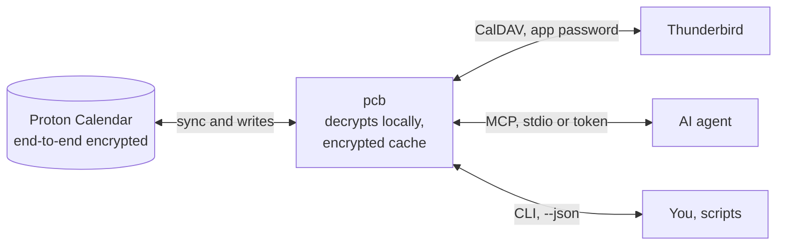

<h1>
  
  
  proton-calendar-bridge
</h1>

[](https://github.com/Barben360/proton-calendar-bridge/actions/workflows/ci.yml?query=branch%3Amain)
[](LICENSE)
[](go.mod)
[](docs/install.md#requirements)
[](docs/status.md)

> [!IMPORTANT]
> proton-calendar-bridge is an independent project. It is not affiliated with, endorsed by or supported by Proton AG. Proton and Proton Calendar are trademarks of Proton AG.

Your [Proton Calendar](https://proton.me/calendar) in Thunderbird and in your AI agents. The calendar counterpart of Proton Mail Bridge.

- **What**: `pcb`, one Go binary that logs into Proton, decrypts your calendars on your machine and serves them over **CalDAV** (read and write) and **MCP** (for AI agents). `pcb-ui` is the same bridge as a desktop app for Linux and Windows.
- **Why**: Proton Calendar is end-to-end encrypted with no public API, so standard calendar apps and agents cannot reach it. pcb does the decryption locally and speaks the standard protocols.
- **Where it runs**: on your Linux desktop with a tray icon, or headless as a systemd service or a container; on Windows 10 and 11 as `pcb-ui`.

> [!WARNING]
> pcb is early software, built and tested against a fake Proton and checked live on a test account. Do not point it at an account you care about yet ([status](docs/status.md)).

## What it does for you

- **Your calendars in Thunderbird**, read and write: create, edit, move and delete events, single occurrences included. Each change goes to Proton and is read back before Thunderbird gets its answer.
- **Your calendars for AI agents**, through MCP: Claude Code or any MCP client lists, searches and, when you allow it, edits events. You decide per agent what it may do, and a delete asks you first when the agent's client supports it.
- **Several Proton accounts in one bridge**, each with its own CalDAV address, passwords, cache and sync, so one account's problem never stops another.
- **Keeps your secrets yours.** The cache is encrypted, the Proton session is sealed with a key held in your desktop keyring or a key file, and passwords never go through command-line arguments. Calendar apps sign in with app passwords you can revoke one by one.
- **Looks after itself.** It follows Proton's change feed, survives restarts, and `pcb doctor` says what is wrong and how to fix it.

## The desktop app

`pcb-ui` puts the bridge in your tray: add an account (password, 2FA code, CAPTCHA), copy the connection into Thunderbird, switch CalDAV or MCP per account, and get a notification when an account needs you. It follows your desktop's light or dark theme.

<p align="center">


</p>

More pictures and every setting: [docs/desktop.md](docs/desktop.md).

## How it works



One process serves every account: the desktop app, the `pcb serve` daemon (systemd or container), or `pcb mcp` started by an agent. The CLI (`pcb status`, `pcb login`, `pcb client show`) talks to whichever one runs, over a local socket (a named pipe on Windows) only your user can open.

## Choose how to run it

| You want | Run | Guide |
|---|---|---|
| The bridge on your Linux desktop, with a tray icon | `pcb-ui` | [desktop](docs/desktop.md) |
| An always-on bridge on a server or a home lab | `pcb install` (systemd) | [service](docs/service.md) |
| The same, in Docker | the container image | [container](docs/container.md) |
| Only an AI agent on this machine, no daemon | `pcb mcp`, started by the agent | [agents](docs/agents.md) |
| The bridge on Windows 10 or 11 | `pcb-ui.exe` from the release zip | [Windows](docs/install.md#windows) |

Install a release (Linux and macOS, amd64 and arm64; no sudo):

```sh
curl -fsSL https://github.com/Barben360/proton-calendar-bridge/releases/latest/download/install.sh | sh
```

It puts `pcb` and `pcb-ui` in `~/.local/bin`, plus the desktop entry on Linux. Flags, checks and macOS: [docs/install.md](docs/install.md). Or build from a clone with Go (version in [go.mod](go.mod)); the "On a desktop" and "Headless" steps below do.

### On a desktop

```sh
git clone https://github.com/Barben360/proton-calendar-bridge && cd proton-calendar-bridge
make install install-ui      # pcb and pcb-ui into ~/.local (pcb-ui needs the GL/X headers: docs/install.md)
pcb-ui                       # then Add account in the window
```

On GNOME, the tray icon needs the AppIndicator extension; without it, the window stays open. Settings, "Start at login" starts it with your session.

### Headless (systemd)

```sh
make install                 # pcb into ~/.local/bin
pcb install                  # a user service running pcb serve; it waits for your login
loginctl enable-linger "$USER"
pcb login                    # username, password, 2FA code at a prompt
pcb client show              # the CalDAV URL, username and password for Thunderbird
pcb doctor                   # every check, with the fix for each failure
```

A system-wide service (`sudo pcb install --system`) and the container are in [service](docs/service.md) and [container](docs/container.md).

## Connect Thunderbird

In Thunderbird: New Calendar, On the Network, format CalDAV. Use the URL, username and password that `pcb client show` prints (or the desktop app's Copy buttons), and keep "Offline support" checked. Each device can have its own revocable password: `pcb client add laptop`.

Proton cannot store everything Thunderbird can: pcb refuses what it cannot keep faithfully (invitations and attendees, some recurrence rules) and never notifies attendees. The list: [docs/thunderbird.md](docs/thunderbird.md#writes-from-thunderbird).

## Give an AI agent your calendar

```sh
claude mcp add --scope user pcb -- pcb mcp                         # read, create, edit, delete events
claude mcp add --scope user pcb -- pcb mcp --profile read-only     # read events, start a login
```

The same commands work with `pcb-ui` running: `pcb mcp` hands the session to it, with no port to set. The account's MCP setting (`pcb account mcp`, or the selector in `pcb-ui`) and the agent's profile both apply, and the stricter wins: an agent edits unless the account is set to Read-only or the agent was added with `--profile read-only` ([details](docs/agents.md#two-settings-the-stricter-wins)).

You type passwords and 2FA codes yourself, in the desktop app or on a one-time local page, never the agent. Text from calendars reaches the agent marked untrusted. An agent on another machine uses `/mcp` with its own token: [docs/agents.md](docs/agents.md).

## Scripts and automation

Every command takes `--json` and prints one envelope, `{schema_version, command, ok, data | error}`, with stable exit codes: `0` done, `2` bad invocation, `10` you must act, `20` blocked or transient, `30` failed and rolled back, `40` partly done and resumable. Secrets come from a prompt, a file descriptor (`--password-fd`) or the environment (`PCB_USERNAME`, `PCB_PASSWORD`, `PCB_TOTP`). Every command: [docs/commands.md](docs/commands.md).

## Documentation

| Page | What is in it |
|---|---|
| [install](docs/install.md) | Installing a release, building, platforms, upgrading. |
| [desktop](docs/desktop.md) | `pcb-ui`: the tray, the window, adding accounts, connecting an agent, start at login, removing it. |
| [service](docs/service.md) | `pcb serve` as a systemd user or system service. |
| [container](docs/container.md) | The image, compose, the key file, a container that restarts in a loop. |
| [Thunderbird](docs/thunderbird.md) | Connecting, app passwords, several accounts, what writes Proton accepts, the listener and TLS. |
| [agents](docs/agents.md) | MCP over stdio or remote, grants, tokens, logins from an agent, audit. |
| [commands](docs/commands.md) | Every command, account selection, `--json`, exit codes. |
| [security](docs/security.md) | Logins and secrets, the sealing key and the desktop keyring, CalDAV passwords, TLS. |
| [troubleshooting](docs/troubleshooting.md) | Symptoms, causes and fixes. |
| [status](docs/status.md) | What is built, what was checked live, what is still to check. |
| [development](docs/development.md) | Tests, the fake Proton, live sessions, screenshots, the design spec. |

The design and its decisions are in [spec/](spec/SPEC.md).

## Contributing

Issues and pull requests are welcome: [CONTRIBUTING.md](CONTRIBUTING.md) says how to build, test and propose a change.

## Credits

Logic reused from another project is audited, rewritten with our own tests and credited here. Nothing below was copied.

<details>
<summary>Projects this one learned from or depends on</summary>

- **cheeseandcereal/proton-cal** (Unlicense): the reverse-engineered API and crypto documentation (`docs/api.md`, `docs/crypto.md`, `docs/overview.md`): the key chain, the locked scope and Proton code 9101, member-level calendar metadata, the v2 bootstrap and the default-calendar setting. Used by `internal/proton/auth`, `keys` and `calendar`.
- **Barben360/proton-cal**, our fork: the two-step CAPTCHA login, the env/TOTP login, and the refresh-token race lesson (one refresh at a time across processes, behind `internal/proton/api` and the token store). Sources audited and rewritten: `pkg/auth` (`auth.go`, `unlock.go`, `loginopts.go`) for `internal/lab/session` and `internal/proton/auth` (SRP login, CAPTCHA stop and resume, TOTP, locked-scope unlock with server-proof check, lock) and `internal/proton/keys` (salts with scope elevation, salted key passphrase check, key unlock); `pkg/calendar` (`calendar.go`, `keys.go`) for `internal/proton/calendar` (calendar list, default calendar, bootstrap, member passphrase decryption, calendar key unlock); `pkg/auth/totp.go` for `internal/otp`. The fork's CLI is also run as an external tool by the data-set seeder (`internal/lab/seed`).
- **go-proton-api**, **go-srp**, **gopenpgp** (MIT, used as libraries). go-proton-api's in-memory test server pattern is the model for and the engine behind our shared fake Proton (`internal/proton/protontest`, an httptest front over its server, which the lab's `internal/lab/labtest` builds on). The developer-only `pcb-lab probe sessions` takes the sessions endpoints and their auth from go-proton-api's `AuthSessions` and `AuthRevoke` (`GET /auth/v4/sessions`, `DELETE /auth/v4/sessions/{UID}`, the session's own token, no extra scope), on our own code and transport (`internal/lab/probe/sessions.go`).
- **develonrails/carbonate**, **WentTheFox/caloxide**, **ProtonMail/WebClients** (GPL-3.0): read only for the client identity strings tried in experiment E03 (`spec/experiments/E03-client-identity.md`). No code from any of them; WebClients is never copied.
- **emersion/go-webdav** (MIT): audited in experiment E17 (`spec/experiments/E17-go-webdav-audit.md`) and **not** used as the server; its CalDAV client, with `go-ical` (MIT), is a test-only dependency that checks our server from the outside and never reaches the binary. It moved `go-vcard` to a newer revision through module version selection (only README and an example differ).
- **modelcontextprotocol/go-sdk** v1.8.0 (the official MCP Go SDK; Apache-2.0, with the contributions not yet relicensed under MIT): the MCP server, transports and test client of the MCP adapter, used as a dependency, nothing copied; audited in experiment E19 (`spec/experiments/E19-mcp-go-sdk.md`). It brings `google/jsonschema-go` (MIT), `segmentio/encoding` and `segmentio/asm` (MIT), `yosida95/uritemplate` (BSD-3-Clause) and `golang.org/x/oauth2` (BSD-3-Clause).
- **Fyne** v2.8.2 (fyne.io/fyne/v2, BSD-3-Clause): the toolkit of `pcb-ui` (window, tray, notifications, headless test driver, which also renders the screenshots), used as a dependency, nothing copied (`internal/ui/desktop`, `cmd/pcb-ui`).
- **Inter** 4.1 (rsms/inter, SIL Open Font License 1.1, license in `internal/ui/desktop/fonts/OFL.txt`): the text font of `pcb-ui`, four static files from the release archive (Regular, SemiBold, Italic, SemiBoldItalic) embedded unmodified (`internal/ui/desktop/theme.go`).
- **fyne-io/oksvg** (BSD-3-Clause, Fyne's fork of srwiley/oksvg) and **srwiley/rasterx** (BSD-3-Clause), both already in Fyne's dependencies: they render `pcb-ui`'s SVG icon to the PNG that becomes `pcb-ui.exe`'s icon at build time (`cmd/pcb-ui/winres`), used as libraries, nothing copied.
- **tc-hib/go-winres** v0.3.3 (0BSD): writes `pcb-ui.exe`'s icon and version resource at build time (`make winres`), run as a pinned tool, never linked into a binary.
- **Microsoft/go-winio** v0.6.2 (MIT): the named pipe of the control channel on Windows, private to the user (`internal/ctl`), used as a library, nothing copied.
- **golang.org/x/sys/windows** (BSD-3-Clause): the Windows calls for the file locks, the replacement of files, DPAPI, the access lists, the registry, the time zone, and `pcb-ui`'s console, session end and file opening, used as a library, nothing copied.
- **godbus/dbus** v5.2.4 (BSD-2-Clause): the D-Bus client of the Secret Service sealer and of the desktop notifications, used as a dependency, nothing copied. The Secret Service client is written from the freedesktop.org specification, with no other implementation read (`internal/store/seal`).
- **Thunderbird's CalDAV provider** (mozilla/releases-comm-central, MPL-2.0): read for experiment E08 (`spec/experiments/E08-thunderbird-caldav.md`), source only, no code copied.
- **develonrails/carbonate** (MIT), **jmdlab/cal-gateway** (MIT) and **WentTheFox/caloxide** (MIT; derives from hydroxide, ferroxide and protoxide, all MIT), for the sync design notes (ideas audited, no code copied; the feed research is in `spec/experiments/raw/m2-feed-research.md`, citations by file and line): carbonate's measured pitfall that a cursor derived at `latest` loses events and its ID-driven re-read that ignores `Action`; jmdlab's order (read the feed head before the full listing) and its rule that a re-read row answering 404 is a delete; caloxide's feed endpoint shapes and its 30 s poll with exponential backoff. Rewritten with our own tests (`internal/syncer`, `internal/store/cache`).
- **WentTheFox/caloxide**, **develonrails/carbonate**, **jmdlab/cal-gateway** (all MIT) and **cheeseandcereal/proton-cal** (Unlicense), for the CalDAV design notes (research, no code copied): what each had to patch around go-webdav (getctag and `supported-report-set`, privileges, sync-collection, body limits), the Proton card-to-iCalendar merge and the one-object-per-UID rule, tolerance of undecryptable events. Rewritten with our own tests (`internal/caldav`, `internal/ical`, `internal/proton/cards`).
- **jmdlab/cal-gateway** (MIT), **cheeseandcereal/proton-cal** (Unlicense), **develonrails/carbonate** (MIT) and **WentTheFox/caloxide** (MIT), for the write design (research `spec/experiments/raw/m4-research.md`, citations by file and line; no code copied, every rule rewritten with our own tests):
  - cal-gateway's alarm rules (`internal/proton/notifications.go`, which it says it ported from the web client): EMAIL to an email notification, DISPLAY and AUDIO to a device one, relative-to-start triggers only, nothing after the start except on all-day events, Proton's per-unit bounds, at most 10, and the tri-state of `Notifications` on update (`internal/ical/alarms_write.go`, `internal/service/writeplan.go`); also its refusals of floating times and `RANGE=THISANDFUTURE`, its RRULE INTERVAL bounds, its mirroring of a full PUT onto master and exception rows, and its rule that a refusal must be an honest 403, never a 2xx no-op;
  - proton-cal's RRULE limits (`docs/api.md`: FREQ, COUNT ≤ 49, UNTIL ≤ 2037-12-31, COUNT and UNTIL exclusive, MONTHLY and YEARLY forms; `internal/ical/validate.go`), its documentation of the sync endpoint, the property routing table, the fragment form, the sealing of each part, session-key reuse on update and full-replace semantics (`docs/api.md`, `docs/crypto.md`; `internal/proton/cards`, `internal/proton/events`, `internal/ical/write.go`), and its patch-in-place update;
  - carbonate's and caloxide's live notes on Proton's refusals (signing with the member's address key, bare `SEQUENCE`, RECURRENCE-ID with RRULE), and caloxide's member permission bits (`Write = 8`, `internal/proton/calendar`).
- **WentTheFox/caloxide** (MIT), for the idle cadence: its standby idea, slowing the poll when nobody uses the bridge (idea audited from the sync research, no code copied). Rewritten with our own definition of idle (no authenticated request for 35 minutes, longer than Thunderbird's 30-minute refresh), a wake on the first request, and our own tests (`internal/service`, `internal/syncer`).
- **Proton Mail Bridge** (and the author's headless Bridge container), for the container and credential model: one `/data` volume, login with `docker exec -it`, state kept in the volume, and a bridge password the user can look up again (`pcb client show`). The usage model only: ideas, no code read or copied; our own image, units and tests (`Dockerfile`, `internal/install`, `internal/ctl`).
- **Unicode CLDR** `windowsZones.xml` release 49 (Unicode License v3, <https://www.unicode.org/license.txt>): the mapping of Windows time zone keys to IANA zones, territory 001 entries only, kept as a table generated by `go generate` (`internal/winzone`, version in `winzone.CLDRVersion`, source file pinned by SHA-256 in the generator). Data, no code.
- The other prior art listed in the [design spec](spec/SPEC.md): design references only; nothing from them is used in this repository so far.

</details>

## License

MIT, see [LICENSE](LICENSE).
